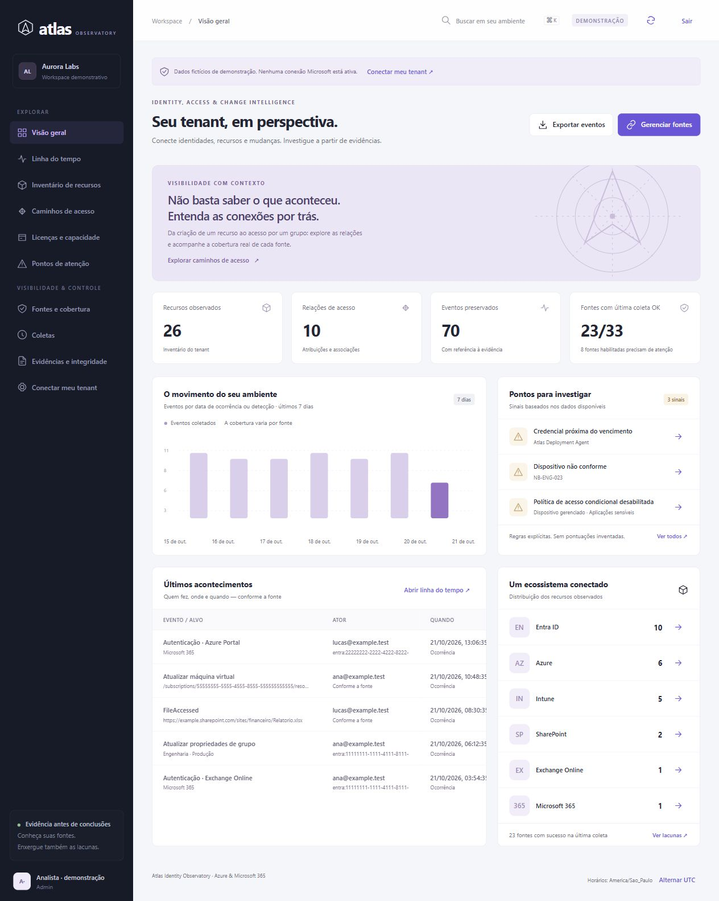

# Atlas · Identity Observatory

**Um observatório de identidades, recursos, permissões e mudanças para Azure e Microsoft 365.**

O Atlas conecta os dados que normalmente ficam distribuídos entre Entra, Azure, Microsoft 365, Intune, Teams, SharePoint e Exchange. Investigue **quem fez o quê, quando e em qual recurso**, explore de onde vem uma permissão e consulte a evidência que sustenta cada informação.

**Status: v0.3 — implementação para piloto e homologação.** Os conectores têm código real e testes com respostas controladas; ainda precisam de validação end-to-end em tenants e infraestrutura Microsoft reais. A demonstração usa dados fictícios, separados de qualquer ambiente real.



## Experimente em poucos minutos

Requisito: Node.js **24** e npm. PostgreSQL não é necessário para a demonstração local.

```powershell
git clone https://github.com/iamjrbro/Atlas.git
cd Atlas
npm ci --ignore-scripts
npm start
```

Abra [http://localhost:3000](http://localhost:3000). Escolha um workspace e perfil. Explore o inventário, a linha do tempo, os caminhos de acesso e a cobertura das fontes. Saia e entre no outro workspace para verificar a separação dos dados. A demonstração usa banco em memória por padrão e é recriada ao reiniciar. Persistência local PGlite é opcional via `DEMO_DATABASE_PATH`; dados locais são ignorados pelo Git.

Para integrar seu tenant: [guia de onboarding](docs/ONBOARDING.md). Para hospedar uma plataforma multitenant: [implantação e operação](docs/DEPLOYMENT.md).

## O que esta versão entrega

| Área                     | Implementação                                                                                                                                                                 |
| ------------------------ | ----------------------------------------------------------------------------------------------------------------------------------------------------------------------------- |
| Identidades e aplicações | Usuários, grupos, membros, proprietários, aplicações, service principals, consentimentos, app roles e papéis Entra                                                            |
| Mudanças e acessos       | Directory Audit, sign-ins, Intune Audit, Azure Activity Log e quatro feeds Management Activity                                                                                |
| Azure                    | Assinaturas acessíveis, Resource Graph, configurações ARM por recurso, custos reais diários por recurso/moeda, RBAC e herança por escopo                                      |
| Microsoft 365            | SKUs, capacidade, consumo, planos e relações de atribuição de licenças por usuário                                                                                            |
| Intune                   | Dispositivos, políticas clássicas e Settings Catalog, segurança de endpoints, baselines, inscrição, scripts/remediações, apps, filtros e atribuições incluídas/excluídas      |
| Teams e SharePoint       | Equipes/membros, sites e grants de aplicações; bridge separado para ACLs de webs/subsites e grupos SharePoint                                                                 |
| Exchange                 | Feed de auditoria; bridge PowerShell para caixas, FullAccess, SendAs, metadados de SendOnBehalf, encaminhamento, regras de transporte, domínios e configuração da organização |
| Plano de dados Azure     | Consulta a tabelas de diagnóstico nos workspaces configurados, quando os logs foram previamente habilitados                                                                   |
| Evidências               | Payload original com contexto, SHA-256, histórico de snapshots, ledger encadeado e exportação                                                                                 |
| Cobertura                | 98 definições de fontes, erros/limites explícitos, janelas de coleta e checkpoints                                                                                            |
| Multitenancy             | Identidade do tenant extraída de token verificado; consultas, evidências, sessões, jobs e bridges segregados por tenant                                                       |

Usuários e grupos têm navegação por relações com nomes, membros paginados, SKUs, planos de serviço e detalhes por usuário. As áreas Intune, Azure e Custos permitem investigar configurações e evidências sem perder o tenant da sessão.

O catálogo de fontes está em [`src/sources.js`](src/sources.js). Fontes Graph têm retomada por cursor, inclusive coletas por grupo/aplicação/site; o snapshot só retira relações não observadas após completar o ciclo. Consulte [cobertura e limites](docs/COVERAGE.md).

## Exemplos de investigação

- **Quem criou essa VM?** Veja os metadados disponíveis e eventos do recurso. Se a fonte não informou autor ou criação, o Atlas mostra isso, sem substituir criação por “primeira vez que vi”.
- **Por que essa pessoa aparece com acesso ao recurso?** Siga identidade → grupo → atribuição → escopo. Papéis, condições e evidências ficam visíveis; isso não é uma decisão definitiva de autorização efetiva.
- **Quem alterou algo no tenant?** Filtre a linha do tempo por ator, recurso, fonte, categoria e período. Horários de ocorrência e coleta são distintos.
- **Quais licenças estão disponíveis?** Confira unidades habilitadas, consumidas, suspensas, planos e atribuições coletadas. Não há valores financeiros presumidos.
- **Por que não aparece um evento?** Consulte o estado e a janela da fonte: falta de permissão, serviço não configurado, retenção, limite e falha são mostrados como lacunas.

## Transparência de cobertura

Nenhuma ferramenta pode garantir “auditar absolutamente tudo” de forma retroativa se o provedor não gerou ou já removeu os registros. O Atlas não transforma ausência de eventos em prova de ausência de atividade. Activity Log não é um log universal de leitura de dados; ACLs de SharePoint não vêm completas do endpoint de permissões de site; licenças e permissões condicionam o que as APIs disponibilizam.

Esta versão **prioriza auditoria e observabilidade**. Não concede/revoga acessos no Microsoft 365, não substitui PIM ou Conditional Access e não oferece o antigo fluxo demonstrativo de concessões do protótipo Atlas v0.1. A única operação administrativa Microsoft fornecida é o helper explícito de ativação das subscriptions do feed; o coletor normal é de leitura.

## Segurança e operação

- Login OIDC com MSAL, authorization code + PKCE, state, nonce e verificação de assinatura/issuer/audience/tempo do ID token.
- App roles Reader/Auditor/Admin conferidos no servidor; o tenant não é selecionado pelo corpo de uma consulta.
- Sessões no servidor, cookies HttpOnly/SameSite/Secure em produção, CSRF, CSP e ausência de tokens no navegador.
- Credencial de collector separada da aplicação web. Produção aceita certificado para o collector; segredo deve ficar em secret store.
- URLs de paginação restritas ao serviço esperado; conteúdo de auditoria validado para o tenant; redirects externos recusados.
- Bridges com HMAC, janela de tempo, nonce e proteção contra replay. Eles atestam a origem do collector, não uma assinatura Microsoft.
- PostgreSQL em produção; PGlite somente para demonstração/testes. Use credencial runtime distinta da credencial de migração.
- Hashes/triggers ajudam a detectar alterações, mas não tornam um banco sob controle de seu proprietário inviolável. Exporte âncoras/evidências para armazenamento externo.

Veja [modelo de segurança](docs/SECURITY_MODEL.md), [política de vulnerabilidades](SECURITY.md) e [operação](docs/DEPLOYMENT.md).

## Desenvolvimento

```powershell
npm run check
npm test
npm audit --omit=dev
./scripts/Test-Collectors.ps1
```

Os testes cobrem isolamento entre tenants, API/RBAC/CSRF, integridade, HMAC/replay, paginação/SSRF, 429, coleta parcial, retomada entre jobs, snapshots, grafo e atribuição desconhecida. Não fazem chamadas à Microsoft. O workflow GitHub também executa smoke test com PostgreSQL 17 e constrói a imagem Docker. Os resultados de CI devem ser consultados no repositório; não substituem homologação Microsoft.

```text
src/                  API, autenticação, coletores, normalização, grafo e ledger
public/               Console em português, sem etapa de build
scripts/              Migração administrativa, bridges e verificações
test/                 Testes locais sem credenciais Microsoft
infra/                App roles e permissões de banco para runtime
docs/                 Onboarding, cobertura, arquitetura e operação
.github/workflows/    CI, PostgreSQL e imagem Docker
```

Contribuições: [CONTRIBUTING.md](CONTRIBUTING.md). Licença [MIT](LICENSE).
