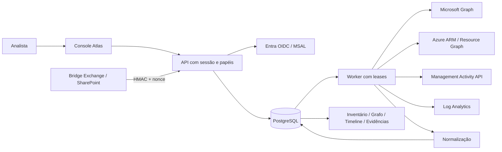

# Arquitetura e modelo de dados

## Entidades

- `tenants`: organizações habilitadas e configuração de fontes/escopo.
- `runs`: jobs com janela, contagem, estado, erro, lease e solicitante.
- `coverage`: último estado e checkpoint por fonte/tenant.
- `collection_cursors`: progresso durável de ciclos Graph, com geração de snapshot.
- `evidence`: payload JSON recebido e contexto, hash e referência à execução.
- `resources`: estado mais recente e horários de criação/primeira/última observação.
- `resource_versions`: versões de propriedades normalizadas com evidência correspondente.
- `edges`: associações, ownership, licenças, grants, papéis e escopos observados.
- `events`: atividade normalizada com ocorrência e coleta distintas.
- `audit_ledger`: operação interna do Atlas em cadeia SHA-256 por tenant.
- `bridge_nonces`: proteção contra replay de snapshots assinados por collectors.

As chaves de recursos são namespaced (`entra:`, `azure:`, `license:`, `mailbox:` etc.) e todas as entidades de negócio possuem tenant. Aliases de UPN/appId conectam certos registros de Exchange/SharePoint às identidades do diretório, sem resolver automaticamente todas as representações de SID/claims.

## Semântica de evidência e snapshot

O payload guarda os valores JSON e contexto da coleta; não é uma captura byte a byte da resposta HTTP nem uma assinatura digital Microsoft. O hash usa representação JSON canônica com chaves ordenadas. Deduplicação considera tenant, fonte, identificador nativo e hash. Eventos usam IDs nativos/determinísticos para evitar duplicidade em janelas sobrepostas.

Snapshot alterado gera evento de **detecção** com autor/ocorrência desconhecidos e antes/depois. Um ciclo incompleto não marca objetos ausentes como removidos. Ao completar, objetos não observados deixam a visão ativa; isso pode representar perda de visibilidade/escopo e não comprova exclusão no provedor. Evidências antigas permanecem.

O ledger serializa a cadeia por lock na linha do tenant. O SHA de cada entrada inclui tenant, horário, ator, ação, alvo, detalhes e hash anterior. Triggers barram update/delete/truncate usuais, mas proprietário/superuser pode remover essas proteções. Armazene periodicamente o head/export em uma âncora externa.

## Isolamento

O token verificado define o tenant da sessão. A aplicação inclui esse tenant em cada consulta de negócio e em cada job. A URL do conteúdo Management Activity também é validada para o mesmo tenant. Configurações de coleta são locais ao tenant autenticado.

O banco **não implementa RLS** nesta versão. O worker/operador usa conexão de plataforma com acesso a múltiplos tenants. Portanto, isolamento depende da aplicação, do papel de banco e dos testes; não deve ser apresentado como isolamento criptográfico entre clientes. Adoção comercial com requisitos superiores demanda RLS, partições/instâncias separadas, autenticação de workload e revisão independente.

## Escala

Uma réplica processa um job por vez. Múltiplas réplicas podem reivindicar jobs usando `SKIP LOCKED`; o índice parcial evita jobs simultâneos normais por fonte/tenant. Leases permitem recuperação após crash. Não há fencing token por worker: uma chamada excessivamente longa ou pausa maior que o lease exige atenção e reconciliação. Ingestão/deduplicação reduz repetição, sem promessa de exactly-once.

Não foram realizados testes de carga de diretórios grandes. Otimize batching, particione tabelas, separe scheduler/workers e estabeleça cotas por tenant antes de operar como SaaS em escala. A política de retenção/arquivamento precisa ser definida pelo operador.
